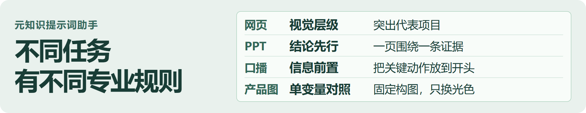

# 元知识提示词助手

**把领域里的专业知识写进提示词，用它约束 AI 怎么做。**

视频里说的「元知识」，就是**知道一个专业方法叫什么、能解决什么问题、什么时候该用**。你用大白话说想做什么、哪里不满意，助手帮你找到合适的方法，把它变成提示词里的**操作规则、必须保留的条件和验收标准**。网页、PPT、口播和设计稿都可以拿来试。

**[💬 复制聊天版](#-聊天版复制使用)**　 **[🧩 安装 Agent Skill](#-agent-skill安装使用)**

## 🌐 看一次改法

**需求摘要**　想做一个有美感的个人网页，但首页全是矩形框和文字，配色和动效也不理想。

**用到的元知识**　网页设计里的「视觉层级」决定访客先看哪项内容。首页区块都一样醒目时，可以用位置、字号和留白让代表项目先被注意到。

**写进提示词**　先试改首页首屏。选一个代表项目，把截图、项目名和查看入口放在一起。其他内容继续保留，弱化与主项目抢注意力的样式。

**改完怎么验收**　请一个没见过页面的人用手机打开首页，看他能否找到代表项目并点进详情。补充项目目标后，可以把配色、动效和手机端要求写进一条完整指令。

## 🚀 快速开始

### 💬 聊天版：复制使用

在电脑或手机上用普通 AI 聊天工具，打开[聊天框版](chat/prompt.txt)，复制全文发进新对话。然后在**同一会话**发送你的想法、旧提示词、原稿或截图。第一次使用可以照着下方的请求试。

### 🧩 Agent Skill：安装使用

**最直接的方式：把仓库链接发给你的 Agent。** 在 Claude Code 或 Codex 里直接说：

~~~text
帮我安装这个 Skill：https://github.com/Yezike-sakura/meta-knowledge-prompt
~~~

**或用 [Skills CLI](https://github.com/vercel-labs/skills/blob/main/docs/commands.md) / 手动安装。** Skills CLI 需要 Node.js 22.20 或更高版本。在你想用 Skill 的项目目录执行，按提示选择 Codex 或 Claude Code。

~~~bash
npx skills add Yezike-sakura/meta-knowledge-prompt --skill meta-knowledge-prompt
~~~

手动安装时，在目标项目目录克隆仓库，再把里面的 **整个技能文件夹** 复制到相应位置。macOS、Linux 或 Windows Git Bash 可以这样做：

~~~bash
git clone https://github.com/Yezike-sakura/meta-knowledge-prompt.git meta-knowledge-prompt-source

# Claude Code，在当前项目使用
mkdir -p .claude/skills
cp -R meta-knowledge-prompt-source/skills/meta-knowledge-prompt .claude/skills/

# 或 Codex，在当前项目使用
mkdir -p .agents/skills
cp -R meta-knowledge-prompt-source/skills/meta-knowledge-prompt .agents/skills/
~~~

用文件管理器手动复制也可以。把 [skills/meta-knowledge-prompt](skills/meta-knowledge-prompt/) 放到项目里的 <code>.claude/skills/</code>（Claude Code）或 <code>.agents/skills/</code>（Codex），保留 <code>SKILL.md</code>、<code>references/</code> 和 <code>examples/</code>。[Claude Code 技能目录](https://code.claude.com/docs/en/skills) · [Codex 技能目录](https://developers.openai.com/codex/skills)

### ▶ 发出第一条请求

启用聊天版后直接发送下面的话。装了 Agent Skill 的读者，可以在新会话的请求前加上 <code>$meta-knowledge-prompt</code>。

~~~text
我的个人网页首页几个区块一样醒目，访客很难马上找到代表项目。
我希望他们优先点开机器人项目。我会附首页截图。
先给我一个首屏试改，再写成能转发给前端 AI 的修改指令。
~~~

拿到回复后，把**代码块里的提示词**和它点名的材料一起交给负责制作的 AI。做完后，按助手给出的检查动作试一次。第二轮可以把新结果和上一条指令一起发回来，指出哪部分已改好、哪里仍然卡住。

## 🧰 下次可以拿什么来

| 你现在遇到什么 | 可以怎么问 |
| --- | --- |
| 有一个想法，迟迟写不出提示词 | 「我要在实验室门口贴招新海报，先让路过的人看到试开小车的时间和报名地点。帮我给排版 AI 写要求。」 |
| AI 做的 PPT 或口播不像你 | 「这页用词太像套版。这是原页和我会上台说的一句话，帮我写一条只改这一页的指令。」 |
| 网页、海报或产品图有方向，细节说不清 | 「同一只陶杯我想比较冷光和暖光。主体、背景和构图都固定，给我两条可以分别试的提示词。」 |
| 第一轮解决了一部分，还差一点 | 「遮住转码帮助这点改对了。但选错文件后还要刷新才能重选。帮我只修这一段。」 |

## 🧭 助手怎么做判断

1. **确定任务。** 找出你要解决的现象、真正想改变的结果，以及必须保留的要求。
2. **看材料够不够。** 材料够用就继续写指令；已有依据、仍缺关键条件时，先给一个可撤回的试改，再问一句；连试改的依据都不足就先问。你若明确说材料稍后发给下游 AI，当前一轮会交付一条能等待材料的指令。
3. **把方法落到动作。** 说明它为什么适用、具体会改变哪个决定，然后把必要材料、修改范围、约束和完成条件写进同一条指令。
4. **试着验收。** 把指令单独交给一个没看过前文的 AI。它应该能知道用什么材料、怎样改，以及改完怎么检查。

[方法辨析手册](skills/meta-knowledge-prompt/references/methods.md) · [第二轮修改指南](skills/meta-knowledge-prompt/references/second-pass.md)

## ✅ 支持范围与验证

独立模型会话已试跑网页首屏、汇报 PPT、跨页表格、延后给材料和局部续改。本地 Codex 已发现技能并识别描述。CLI 自动触发到完整文件加载的路径仍待复测。

助手负责找方法、写指令和给检查动作。PPT、网页或视频成品由能读取原素材并具备制作能力的工具完成。你只要求当前 Agent 直接做成品时，当前任务按原请求执行。

## ❓ 常见问题

没有原文件，我该给它什么？

发一句想达到的目标和你已经发现的具体问题，例如「这页内容太平均，访客找不到报名入口」。这些线索可以先支持一项试改。需要另一项关键信息时，助手会问一句。

对方 AI 只能读文字，怎么继续？

要求它交付能用的东西，例如逐页文案、排版说明、剪辑单或验收步骤。要改实际文件时，把指令和原材料交给具备相应能力的工具。

Codex 里找不到技能，怎么检查？

确认当前目录在安装的项目内，且 <code>meta-knowledge-prompt/</code> 下直接包含 <code>SKILL.md</code>。新开会话，再用 <code>$meta-knowledge-prompt</code> 显式调用一次。

## 📁 文件索引

| 文件 | 用途 |
| --- | --- |
| [chat/prompt.txt](chat/prompt.txt) | 适合直接粘贴到聊天工具 |
| [SKILL.md](skills/meta-knowledge-prompt/SKILL.md) | Agent 的调用条件、流程与交付标准 |
| [references/](skills/meta-knowledge-prompt/references/) | 方法辨析、交接指令和续改 |
| [examples/field-guide.md](skills/meta-knowledge-prompt/examples/field-guide.md) | 完整教学示例 |
| [docs/validation.md](docs/validation.md) | 试用记录与验证边界 |

## 🙏 来源与致谢

这个项目来自《元知识》口播里的问题：AI 已经做出东西了，怎样把自己说不清的「再改改」变成具体要求？提示词技巧的分享受到「大师的 AI 小灶」启发。[选题参考](https://v.douyin.com/bt7GF6xwIPA/)

## 📄 许可证

本项目采用 [MIT License](LICENSE)。你可以免费使用、修改和再发布。分发包含本项目全部或实质性部分的副本时，请保留原版权声明和许可证文本。

Copyright (c) 2026 Yezike-sakura
